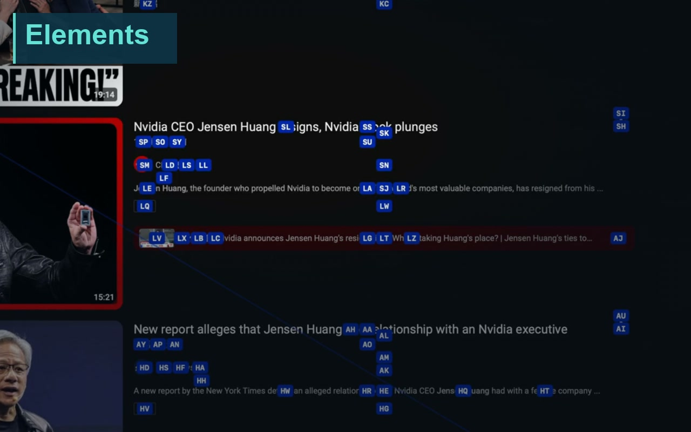

# TranSeek

TranSeek is a macOS app for navigating on-screen text and controls with your keyboard. Press Caps Lock to start, then search for a word, type a hint to activate a control, or choose a pane to scroll.

**Requires an Apple silicon Mac running macOS 15 or later.**

[Download for Mac](https://transeekmac.com/releases#download) · [View screenshots](#screenshots) · [Visit the website](https://transeekmac.com/)

## What you can do

- **Search on-screen text.** Type part of a word to narrow the results, then press Return to click the selected match.
- **Browse by initial letter.** Use Alphabet mode to jump between groups of recognized words.
- **Activate controls.** Type a hint to click an accessible button, link, or other control. Browser integration can also find interactive controls on webpages.
- **Scroll with the keyboard.** Select an on-screen scroll area and move through it using your configured keys.
- **Translate recognized text.** Configure a supported language pair to translate a selected word or a full screen of recognized text.
- **Customize your modes.** Set their order, shortcuts, and overlay appearance in Settings.

## Screenshots

| Search | Alphabet |
| --- | --- |
|  |  |

| Elements | Scroll |
| --- | --- |
|  |  |

## Get TranSeek

[Download the DMG](https://transeekmac.com/releases#download), open it, and follow the installation instructions. Grant **Accessibility** permission for control navigation and **Screen Recording** permission for modes that recognize on-screen text.

The separate `.Sparkle.zip` is for the built-in updater. Find installers and release notes in [GitHub Releases](https://github.com/Tumerit-LLC/TranSeek/releases).

## Support and privacy

For a bug report or feature request, open a [GitHub issue](https://github.com/Tumerit-LLC/TranSeek/issues). Include your macOS and TranSeek versions, steps to reproduce, and browser and extension versions if relevant. For purchases, activation, and private account details, use [TranSeek Support](https://transeekmac.com/support).

See the [privacy policy](https://transeekmac.com/privacy) for details about the app and its browser extension.

## Release maintenance

See the [release and localization guide](.github/RELEASING.md) for signing, publishing, and translating Sparkle release notes.
